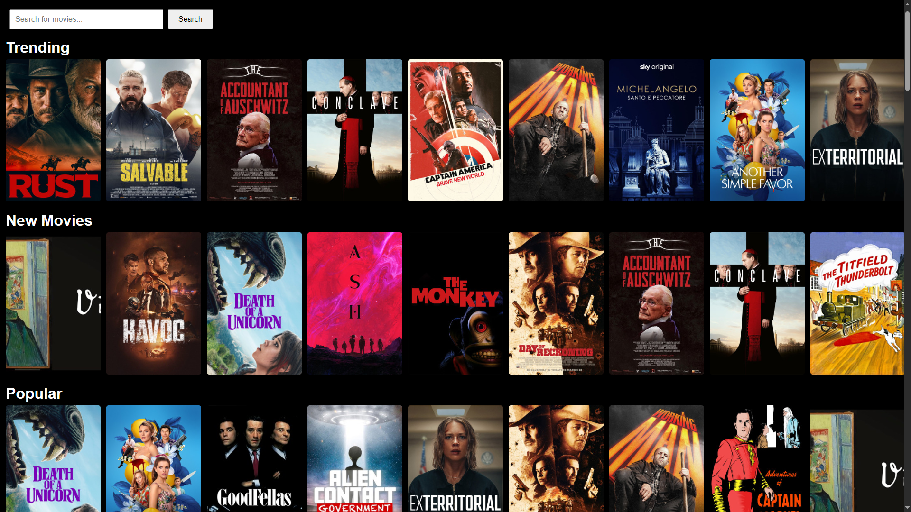
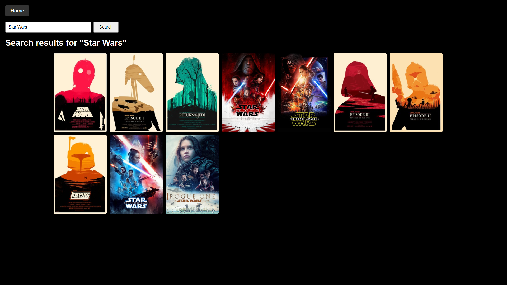
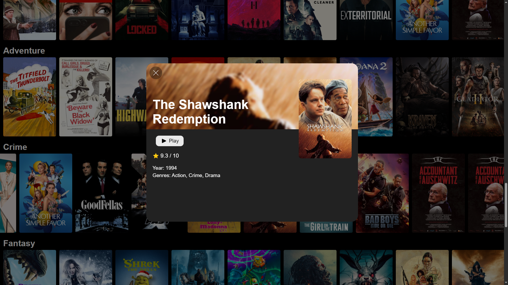
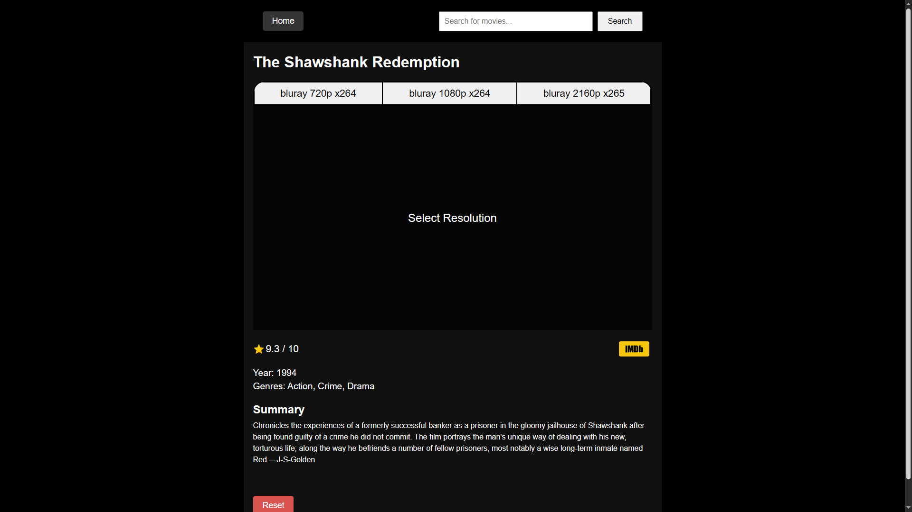

# 🎬 Streamify

Streamify is a seamless, modern, and powerful streaming platform that lets you watch **any movie or series entirely for free** — no subscriptions, no fees, no hassle. Powered by a Vue.js frontend, a Node.js backend, and a PostgreSQL database, Streamify aggregates details, images, and torrent links from multiple APIs and delivers a smooth streaming experience right in your browser.

## 🌟 Features

- 🔍 **Search and Explore**: Find any movie or series using a powerful search and discovery interface.
- 📺 **Series**: Every season and episode, with a next episode button, an "up next" countdown, and the history picking up at the episode where you left off.
- 🧲 **Episode Torrents Like Stremio**: Episodes are found through Stremio torrent add-ons (Torrentio by default), ranked for your browser, and checked live, so a slow or dead source is pointed out or swapped for a better one.
- 🎛️ **Plays Any Format**: Episodes the browser can't play as they are (MKV with Dolby or DTS sound, HEVC) are converted on the fly with ffmpeg.
- 🎞️ **Detailed Movie Info**: Access high-quality posters, summaries, genres, and other metadata.
- 🚀 **Instant Streaming**: Backend fetches torrents and streams movies directly to the frontend.
- 💾 **Caching System**: Torrents are cached with an inactivity timeout to save space.
- 🧼 **Clean & Modern UI**: Built with Vue to give users a Netflix-like experience without the price tag.
- 💡 **No Subscriptions Needed**: Watch everything without logging into a streaming service.

## 🖼️ Screenshots

### 🏠 Home Page (Movie Catalog)
Browse a beautiful grid of popular and trending movies that refresh every 7 days.

### 🔍 Search Page

### 🎬 Movie Details Page
Click on any movie to view its metadata, Play button, and cover image.

### ▶️ Movie Watch Page
Start watching any movie instantly.

## 🛠️ Tech Stack

| Layer       | Technology         |
|-------------|--------------------|
| Frontend    | Vue.js             |
| Backend     | Node.js (Express)  |
| Database    | PostgreSQL         |
| Other Tools | APIs for movie metadata, searching and getting torrents |

## 📫 Contact
If you want to use Streamify yourself, feel free to contact me via email at **vencislav@manoilov.email**.
